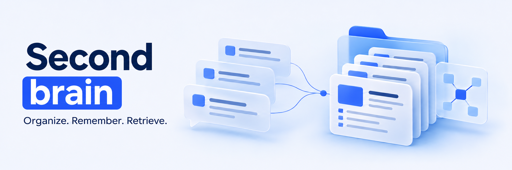

<p align="center">
  
</p>

# A second brain for your AI agent

**Folders that make sense. Memory that lasts. Conversations that are still useful tomorrow.**

You give your agent context, explain your preferences, and make decisions together. Then you open a new conversation and have to explain some of it all over again.

This guide helps you build a memory your agent can search and enrich as you work. You move forward together, one question at a time, while staying in control of access and changes.

<p align="center">
  <a href="organize.md">01 · Organize</a> &nbsp; → &nbsp;
  <a href="level-1.md">02 · Remember</a> &nbsp; → &nbsp;
  <a href="level-2.md">03 · Consolidate</a>
</p>

> **This repository contains prompts and skills, not an installer.** The agent must examine your environment, check its capabilities, and guide you before changing anything. Compatibility depends on the agent and its version; having these files does not guarantee it.

## Get started

1. **Choose your starting point** from the table below.
2. Open the file and copy only the **“Prompt to copy”** block.
3. Paste it into a conversation with the agent you want to configure.
4. Answer its questions and approve each step as you go.

You do not need to clone the repository to read or copy the prompts. To work on your folders, however, the agent needs the appropriate tools and access. If it cannot move files itself, it can guide you through doing it yourself.

## The path

| Step | When to use it | What you set up |
| :--- | :--- | :--- |
| **[01 · Organize your folders](organize.md)** | Your documents are scattered or their organization is unclear. | An organization that fits how you work, filing rules, and guidance for the agent. |
| **[02 · Set up memory — level 1](level-1.md)** | You want to retrieve your preferences, decisions, and knowledge across conversations. | Long-term knowledge notes, an index, context loaded at the start of each session, and conversation search. |
| **[03 · Add the dreamer — level 2](level-2.md)** | Your memory already works and you also want to enrich it from past conversations. | A periodic process that rereads authorized conversations and consolidates knowledge. |

**Already happy with your folder organization?** Start at level 1. **Already have a memory system?** Level 2 starts by analyzing it: it must not create a second one alongside it.

### 01 · Give your documents a home

The agent starts by understanding your activities and examining the folders you authorize it to read. It then suggests an organization, without imposing a one-size-fits-all folder structure.

Files are moved in small, approved batches: **either the agent moves them, or you do it with its guidance, one action at a time**. Filing guides, links, and destinations are checked after the changes.

### 02 · Keep what is worth keeping

Memory is not about piling up transcripts. It retains useful information: preferences, decisions, knowledge, project context, and ways of working.

Level 1 separates:

- **Instructions**: how the agent should work and maintain memory.
- **Startup context**: an index and a short general context.
- **Knowledge notes**: detailed knowledge, consulted when relevant.
- **Conversation histories**: the original exchanges, which the agent can search.

The agent writes as you work. Loading mechanisms are adapted to its documented capabilities, including after context compaction where supported.

### 03 · Consolidate with the dreamer

The dreamer adds a second way to maintain memory. **The main agent continues writing as usual.**

The dreamer rereads authorized main conversations, distinguishes historical information from what is still valid, and enriches existing knowledge notes. Unresolved contradictions remain explicit; extracted knowledge points back to the source conversations.

| Setting proposed during setup | Starting value |
| :--- | :--- |
| Check for new exchanges | Every 15 minutes |
| Inactivity before processing | More than one hour |
| Batch size | 2 conversations |
| Model | The current agent’s model as a starting point, with a recommendation suited to your needs |

All of these choices are configurable. **No model calls when there is nothing new to process.** Existing conversation history is inventoried before proposing to process it all, gradually and with your approval.

Once you accept its mandate, the dreamer can modify and reorganize knowledge notes without approval for every change. The prompt therefore requires concurrency safeguards, resumable progress, and a pause after repeated failures. A first real batch is checked before you are asked to authorize automation.

## Three skills for working with your agent

A *skill* is a set of reusable instructions for a task. This repository provides three: two to help you work better with your agent and one to develop your second brain further.

| Skill | What it does | Example request |
| :--- | :--- | :--- |
| **[Brainstorming](skills/idea-brainstorming/SKILL.md)** | Clarify an idea, examine its assumptions and risks, then reach an explicit decision. One question at a time. | “Challenge this idea and help me decide before we implement it.” |
| **[Handoff](skills/handoff/SKILL.md)** | Prepare a self-contained prompt to resume work in a new conversation. | “Prepare a handoff so I can continue this work in a new session.” |
| **[Brain Level Up](skills/brain-level-up/SKILL.md)** | Analyze your system and how you use it, explore possibilities on the web and GitHub, then build an improvement with you. | “Level up my second brain: explore what we could improve or make possible.” |

Handoff responds directly in the conversation: it does not create a file, launch an agent, or write to memory.

**Going further after setup:** Brain Level Up alternates between diagnosis, research, and questions, without changing your system during exploration. It can suggest a simplification, a new capability, or a redesign, then guide the implementation of the plan you explicitly approve. You can run it again as your needs evolve; level 2 is not a required prerequisite.

<details>
<summary><strong>How do you add these skills to your agent?</strong></summary>

Download the folder for the skill you want from `skills/`, or give its `SKILL.md` file to your agent. Ask it to check its documentation for the supported installation mechanism, then propose changes before making them.

There is no universal installation path. Copying a file to disk does not prove that the agent discovers or loads it: check this with your agent before relying on it.

</details>

## Before granting access to your data

- **Start with a limited scope.** Permission to read is not permission to move, delete, or publish.
- **Local files do not mean local processing.** If your agent uses a remote model, the excerpts it reads may be sent to its provider.
- **Do not put secrets in memory.** Passwords, tokens, and API keys belong neither in knowledge notes nor in diagnostics.
- **Do not confuse an instruction with a safeguard.** Filtering, recovery, and concurrent writes must be verified in the actual environment.
- **Review the results.** A model can misinterpret a conversation. A successful first batch does not guarantee the quality of later ones.

This repository is for the guide’s resources. **Your personal memory, conversation histories, and private configuration must stay outside the public repository.**

## Repository contents

```text
.
├── README.md
├── organize.md                  # Folder organization
├── level-1.md                   # Memory setup
├── level-2.md                   # Adding the dreamer
├── assets/
│   └── second-brain-banner.png
└── skills/
    ├── brain-level-up/
    │   └── SKILL.md
    ├── idea-brainstorming/
    │   └── SKILL.md
    └── handoff/
        └── SKILL.md
```

## References and credits

- [John Conneely — How I Finally Sorted My Claude Code Memory](https://www.youngleaders.tech/p/how-i-finally-sorted-my-claude-code-memory): a reference for separating instructions, the index, and knowledge.
- [Official Claude Code hooks documentation](https://code.claude.com/docs/en/hooks#sessionstart): an example of a loading mechanism. Each installation must check the documentation for the agent being used.
- [Matt Pocock’s Handoff](https://github.com/mattpocock/skills/blob/5863806dd4e15c63174bee4e7515a4256792ecfa/skills/productivity/handoff/SKILL.md): the original reference for the handoff skill. The version in this English guide is based on the French adaptation, with output that can be copied directly from the conversation.

The banner was generated with an image model. The prompts describe a guided setup process; they do not certify that it works with every agent.
